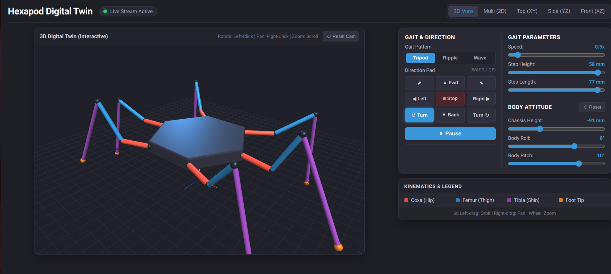

# BKHexapod Control Software

This project is the Python-based control software for an 18-DOF, 6-legged (hexapod) robot.
The focus is on creating a clean, modern, and testable object-oriented architecture with an integrated 3D Digital Twin, omnidirectional gaits, seamless gait morphing, and body attitude control.



## Physical Specifications

All physical dimensions are fully configurable in `src/bkhexapod/config.yaml`:
- **Leg Limb Lengths (inter-axis distances):**
  - **Coxa:** 6 cm (60 mm)
  - **Femur:** 10 cm (100 mm)
  - **Tibia:** 13 cm (130 mm)
- **Chassis Dimensions (mount point axes):**
  - **Front & Rear width:** 13 cm (130 mm, $X = \pm 65\,\text{mm}$)
  - **Middle width:** 15 cm (150 mm, $X = \pm 75\,\text{mm}$)
  - **Axis distance along body:** 9 cm (90 mm, $Y = -90\,\text{mm}$ front, $0\,\text{mm}$ middle, $+90\,\text{mm}$ rear)

## Current Status & Features

- **Full Software Simulation & Hardware Driver:**
  - Execute full software simulation without physical hardware using `MockPWMDriver`.
  - Drive physical hardware via dual PCA9685 I2C boards (`0x40` left, `0x41` right) using `RealPCA9685Driver`.
  - Hardware diagnostic and test suite via `check_hardware.py` (I2C scanning, servo centering, sweep, and relax).
- **Configuration-Driven Geometry & Servos (`config.yaml`):**
  - Centralized Single Source of Truth for limb dimensions, chassis mounting points, default stance, and 18-channel servo calibration.
  - Strongly-typed parsing with dataclasses (`LimbConfig`, `ChassisConfig`, `GeometryConfig`, `ServoConfig`).
  - Automatic fallback support for `servos.yaml`.
- **Inverse Kinematics (IK):** Accurate 3-DOF insect-leg kinematics translating `(x, y, z)` target foot tip coordinates into joint angles (Coxa, Femur, Tibia). Features a natural insect posture with raised knees and ground-directed tibias without servo clamping.
- **Omnidirectional Locomotion Engine (`OmniGait`):**
  - **Omnidirectional Translation:** Holonomic walking in any direction (forward/backward along $Y$, lateral strafing along $X$, or arbitrary diagonal vectors).
  - **Yaw Rotation (Turn in Place):** In-place rotation around the robot's central vertical axis ($Z$) with mathematically derived tangential foot trajectories.
  - **Curved Walking:** Simultaneous translation and rotation for smooth arc turns.
- **Multi-Gait Coordination & Seamless Morphing:**
  - **Tripod Gait (`TripodGait`):** Fast, dynamic gait with 3 legs in stance and 3 in swing (duty factor $0.5$).
  - **Ripple Gait (`RippleGait`):** Smooth, insect-like gait with 4 legs in stance and 2 in swing (duty factor $0.67$).
  - **Wave Gait (`WaveGait`):** Metachronal wave with 5 legs in stance and 1 in swing for maximum static stability (duty factor $0.83$).
  - **Seamless Gait Morphing:** Continuous S-curve interpolation of duty cycle and circular phase offsets between gaits without jumps or stuttering.
  - **Inertial Velocity & Trajectory Slew-Rate Limiting:** Smooth acceleration/deceleration and servo protection against abrupt coordinate changes.
- **Body Attitude & Posing Control (6-DOF Chassis Posing):**
  - **Chassis Height:** Variable ground clearance ($-40\,\text{mm}$ to $-120\,\text{mm}$, default $-80\,\text{mm}$).
  - **Body Roll:** Dynamic lateral tilting around the longitudinal axis ($\pm 25^\circ$).
  - **Body Pitch:** Dynamic nose up / nose down tilting around the lateral axis ($\pm 25^\circ$).
  - Applicable both while standing still (attitude posing) and dynamically during walking.
- **Interactive 3D Digital Twin & Multi-View Visualizer:**
  - Launchable via `--visualize` on `http://localhost:8000`.
  - **Interactive 3D View (WebGL / Three.js):** 360° rotation, pan, zoom with OrbitControls, ground grid, lighting, and real-time 60 FPS mesh rendering of body chassis and limb segments.
  - **Multi-View 2D Projections:**
    - **Top View (XY):** Heading, stride, and yaw trajectory.
    - **Side View (YZ):** Step clearance, ground level ($Z = -80\,\text{mm}$), and body profile.
    - **Front View (XZ):** Lateral stance, knee elevation, and body roll.
  - **Bidirectional Web Controls:**
    - **Direction Pad & Keyboard (WASD / QE / Space):** Forward, Backward, Strafe Left/Right, Turn Left/Right, Stop.
    - **Gait Selector:** Instant toggle between Tripod, Ripple, and Wave gaits.
    - **Gait Parameters:** Live sliders for Speed ($0.1\times - 3.0\times$), Step Height ($10 - 60\,\text{mm}$), Step Length ($10 - 80\,\text{mm}$).
    - **Body Attitude Sliders:** Live Height, Roll, and Pitch adjustment with one-click "Reset Pose".
  - **Network-Ready & Offline:** Binds to `0.0.0.0` with dynamic WebSocket connection so you can control your robot from any laptop, tablet, or smartphone on your Wi-Fi network.
  - **Graceful Lifecycle:** Clean shutdown of HTTP and WebSocket servers with automatic port release on `Ctrl+C`.
- **Automated Test Suite:** Comprehensive test coverage via `pytest` (32 unit & integration tests) verifying geometry loading, inverse kinematics, gait engines, gait morphing, strafing, turning, body attitude posing, WebSocket bidirectional streaming, hardware drivers, and server lifecycle.
- **Professional Project Structure:** Modern `src`-layout, dependency management via `pyproject.toml`, and strict PEP 8 type hints.

## Architecture & Design Principles

The project adheres to several key design principles:

1. **Configuration Driven:** All physical limb dimensions, chassis mounting coordinates, and servo calibration details are defined in `src/bkhexapod/config.yaml` (with `servos.yaml` fallback), keeping the robot control logic generic.
2. **Object-Oriented Hierarchy:** Logical hardware modeling:
   `Hexapod` (6 `Legs`) $\rightarrow$ `Leg` (3 `Joints`) $\rightarrow$ `Joint` (powered by `Servo`).
3. **Dependency Injection & Protocols (Interfaces):**
   - **`PWMDriverProtocol`:** Decouples robot logic from hardware. Can inject `MockPWMDriver` for simulation or `RealPCA9685Driver` for physical execution without modifying robot code.
   - **`GaitProtocol`:** Decouples gait algorithms (Strategy Pattern). Allows switching between `TripodGait`, `RippleGait`, `WaveGait`, or custom walking patterns at runtime.
4. **`src`-Layout:** Python source code resides cleanly in `src/`, separated from project configuration, static assets, tests, and documentation.

## How to Run

1. **Install Dependencies:**
   To install the project in editable mode including development tools:
   ```bash
   pip install -e ".[dev]"
   # or with uv:
   uv pip install -e ".[dev]"
   ```

2. **Run the Automated Test Suite:**
   To run all 32 unit and integration tests:
   ```bash
   pytest -v
   ```

3. **Run the Simulation with Digital Twin:**
   Starts the robot controller, HTTP web server (port 8000), and WebSocket streaming server (port 8765):
   ```bash
   python main.py --visualize
   ```
   Open your browser and navigate to `http://localhost:8000`.

4. **Run on Physical Hardware:**
   On Raspberry Pi with PCA9685 boards attached to I2C bus 1:
   ```bash
   python check_hardware.py --scan
   python main.py --hardware --visualize
   ```

## Controls Reference (Web UI & Keyboard)

| Control | Key | Action |
| :--- | :--- | :--- |
| **Forward** | `W` / `↑` | Walk forward along $Y$-axis |
| **Backward** | `S` / `↓` | Walk backward along $Y$-axis |
| **Strafe Left** | `A` / `←` | Walk sideways to the left along $X$-axis |
| **Strafe Right** | `D` / `→` | Walk sideways to the right along $X$-axis |
| **Turn Left** | `Q` | Rotate in-place counter-clockwise around $Z$-axis |
| **Turn Right** | `E` | Rotate in-place clockwise around $Z$-axis |
| **Stop Motion** | `Space` | Immediately halt walking and plant all feet |
| **Pause/Resume** | Button | Freeze/unfreeze animation loop |
| **Chassis Height**| Slider | Adjust ground clearance ($-110\,\text{mm}$ to $-50\,\text{mm}$) |
| **Body Roll** | Slider | Tilt chassis laterally left/right ($\pm 20^\circ$) |
| **Body Pitch** | Slider | Tilt chassis longitudinally nose up/down ($\pm 20^\circ$) |
