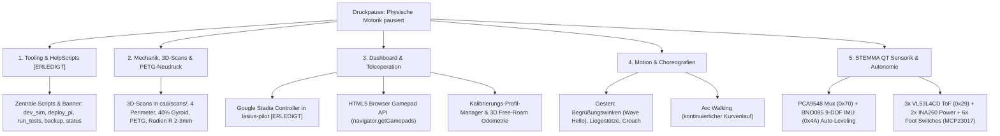

# Lasius Hexapod – Aufgabenliste, Backlog & Ideensammlung

Dieses Dokument dient als zentrale Aufgabenliste, Roadmap und Ideensammlung für die Weiterentwicklung des Lasius Hexapod-Roboters (Einrichtung, Entwickler-Workflows und Help-Skripte sind in [`README.md`](README.md) dokumentiert).

---

## 1. Aktueller Projektstatus (Stand: Oktober 2026)

### Mechanischer Status
* **Status:** ⚠️ **Physische Gesamt-Motorik pausiert.**
* **Ursache:** Mehrere 3D-gedruckte Coxa-Trägerteile (Hüftgelenke) sind unter Last gebrochen und müssen neu gedruckt werden.
* **Konsequenz:** Physische Geh- und Belastungstests auf dem Schreibtisch/Boden sind vorübergehend ausgesetzt, bis die verstärkten Neudrucke montiert sind.

### Software- & Digital-Twin-Status
* **Status:** ✔ **100 % betriebsbereit, modular und autark simulierbar.**
* **Backend (`lasius-core`):**
  * 4-Schichten-Architektur (HAL, Kinematik/Motion, OrderDispatcher, HTTP REST & WebSocket Server).
  * 50 Hz Harmonic-Cosine-Locomotion-Engine ($C^1$-stetig, >5-fache Ruck-Reduktion) mit `engage=False` beim Serverstart (Servos beim Booten sicher stromlos) und expliziter [`locomotion_active`](lasius-core/src/lasius/core/robot.py)-Zustandsmaschine.
  * Thread-sicherer I2C-Bus (`threading.RLock`) und deaktiviertes PCA9685 `_ALLCALL`-Bit (`0x70`) in [`driver.py`](lasius-core/src/lasius/core/hardware/driver.py) zur Vorbereitung des PCA9548 I2C-Multiplexers.
  * Ruckfreie Kosinus-Einstiegs- und Ausstiegsinterpolation in [`dispatcher.py`](lasius-core/src/lasius/core/control/dispatcher.py): Startwinkel basieren auf Live-Servowinkeln oder Stance-Höhe ($z = -80\,\text{mm}$), kein 0°-Durchsacken mehr.
* **Frontend (`lasius-dashboard`):**
  * Moderne Vue 3 + TypeScript + Pinia Single-Page Application (SFCs, `JointCard.vue` wiederverwendbar).
  * 3D Digital Twin (Three.js WebGL via `shallowRef` & Zero-Leak Buffer-Updates [`updateFanGeometry`](lasius-dashboard/src/engine/lasiusGraphics.ts) / [`disposeObject3D`](lasius-dashboard/src/engine/lasiusGraphics.ts)): Doppelplatten-Sandwich (zwei 5 mm Platten, 24 mm Abstand, Standoffs), Coxa 30 mm nach innen verlängert, einheitliches PBR-Material (`#343746`), blaues Richtungsdreieck auf Deck.
  * 2D CAD-Orthogonalprojektionen: Rein geradlinige Vektoren (`ctx.lineTo`) ohne Bogenkrümmung.
* **Teleoperation (`lasius-pilot`):**
  * Native Unterstützung für **Google Stadia Controller** (inkl. automatischer Profil-Erkennung `--profile auto | stadia | standard`; siehe [`GAMEPAD_STADIA.md`](GAMEPAD_STADIA.md)) sowie PS4/PS5, Xbox und 8BitDo via Linux `/dev/input/js0`.
* **Automatisierte Tests:**
  * **59 Tests** (55 in `lasius-core`, 4 in `lasius-pilot`), 100 % bestanden.

---

## 2. Aufgaben-Backlog & Todos (während der Druckpause)

Da das gesamte System dank [`MockPWMDriver`](lasius-core/src/lasius/core/hardware/driver.py) und dem 3D Digital Twin unabhängig von echter Hardware auf dem Laptop simulierbar ist, kann die Entwicklung nahtlos fortgesetzt werden:

### Todo 1: Einrichtung, How-to und HelpScripts [✔ ERLEDIGT]
* **Ziel:** Einheitliche Skripte für den schnellen Entwickler-Alltag (Simulation, Deployment, Backup, Health-Check) inkl. zentralem ASCII-Banner [`scripts/banner.txt`](scripts/banner.txt).
* **Dateien:** Ordner [`scripts/`](scripts/) mit ausführbaren Bash-Skripten (Dokumentation & Workflows siehe [`README.md`](README.md)).

### Todo 2: Mechanische Optimierung & CAD-Reconstruction der Beinteile (`cad/scans/`)
* **3D-Scan & Reverse Engineering:**
  * Gebrochene Originalteile (Coxa 60 mm, Femur 100 mm, Tibia 130 mm) mit revoscan einscannen und als `.stl` / `.obj` in [`cad/scans/`](cad/scans/) ablegen.
  * Parametrisches Nachmodellieren als saubere Volumenkörper (Solids) mit exakten Gelenkabständen (**60 mm / 100 mm / 130 mm**).
* **Konstruktive Maßnahmen & Slicer-Vorgaben vor Neudruck:**
  * **Material:** **PETG** (zäh-elastisch, bricht nicht spröde unter Schocklast).
  * **Schichtorientierung:** Teile flach auf dem Druckbett liegend drucken, damit die Zug- und Biegespannungen entlang der Endlos-Filamentbahnen verlaufen (keine Z-Layer-Trennung an den Gelenkaugen).
  * **Wandlinien & Infill:** **4 Wandlinien (1,6 mm Wandstärke)**, **40 % Gyroid-Infill**, **5 Top/Bottom-Layer (1,0 mm)**, 0,20 mm Schichthöhe bei leicht erhöhter Drucktemperatur (240–245 °C) und reduziertem Bauteillüfter (max. 20–30 %) für optimale Layer-Adhäsion.
  * **Geometrie-Verstärkungen:** Scharfe 90°-Innenecken mit Radien ($R \ge 2\text{--}3\text{ mm}$) ausrunden, Wandstärke um Servohorn-Aufnahmen (25T) und Gegenlager auf $\ge 3{,}5\text{--}4{,}0\text{ mm}$ erhöhen und M3-Einschmelzmuttern (Heat-Set Inserts) vorsehen.

### Todo 3: Dashboard & Teleoperation (100 % Software)
* **Google Stadia & PS5 DualSense YAML-Profile (`lasius-pilot` & `lasius-dashboard`) [✔ ERLEDIGT]:**
  * Deklarative YAML-Profile (`profiles/ps5.yaml`, `profiles/stadia.yaml`, `profiles/xbox.yaml`) mit automatischer Erkennung und manuellem Umschalter im Dashboard (`GET /api/v1/gamepads`) sowie Browser-Steuerung über `navigator.getGamepads()`.
* **Kalibrierungs-Profil-Management (Download / Upload) [✔ ERLEDIGT]:**
  * Export/Download der `calibration.json` als JSON-Datei (`⬇ Export JSON`) und Upload/Restore (`⬆ Import JSON`) direkt im Tab *Leg Control*.
* **3D Bodenkontakt-Indikatoren & Fuß-Trajektorien (Foot Trails) [✔ ERLEDIGT]:**
  * Live-Bodenkontakt-Ringe unter den Tibia-Spitzen bei Standphase ($z \le -75\,\text{mm}$) sowie ein-/ausblendbare 3D-Trajektorien-Spuren (`Trails: ON/OFF`) im 3D-Viewport.
* **Kinematische Boden-Koppelung (`Ground Lock` vs. `Test Stand`) & Odometrie-Grid [✔ ERLEDIGT]:**
  * 2-stufige Least-Squares-Stützebenen-Berechnung (`fitSupportPlane` & `computeWorldKinematics`) im 3D Digital Twin und in den 2D Front-/Seitenansichten: Stützfüße bleiben exakt auf dem Boden ($Z = -80\,\text{mm}$), während sich das Chassis bei *Push-Ups*, *Crouch*, *Body Circle*, *Roll/Pitch* und Gehen physikalisch korrekt hebt, senkt und neigt.
  * Schlupffreier Boden-Vortrieb: Das 3D-Bodenraster scrollt und rotiert synchron unter den aufgesetzten Standbeinen (`Ground: ON`), jederzeit umschaltbar auf den fixierten Prüfstands-Modus (`Test Stand`).
* **Externe Starrkörper-Physik-Bridge (MuJoCo / PyBullet via URDF/MJCF) [Backlog / Zukunft]:**
  * Export der Lasius-Geometrie aus `config.yaml` als MJCF/URDF-Modell für **MuJoCo** (bzw. PyBullet/Gazebo), angekoppelt über den bestehenden 50-Hz-WebSocket-Stream (`ws://...:8765`), um echte Starrkörper-Dynamik (Schwerkraft, Kippmomente, Fußreibung, unebenes Terrain und Servo-Drehmomentgrenzen) zu simulieren.

### Todo 4: Gesten, Posen & Choreografien (`lasius-core`)
* **Show-Posen & Acrobatic Actions [✔ ERLEDIGT]:**
  * `WAVE_HELLO`: Vorderbein anheben und die Tibia/Coxa hin- und herwinkend schwenken (während die 5 Stützbeine sicher im Stance stehen).
  * `PUSH_UPS`: Rhythmisches Auf- und Absenken des Körpers über Sinus-Interpolation ($-50\,\text{mm}$ bis $-108\,\text{mm}$).
  * `BODY_CIRCLE`: Geschmeidiges 6-DOF-Kreisen des Körpers über gekoppelte Roll- und Pitch-Winkel.
  * `CROUCH`: Tiefe Lauerstellung mit geneigter Nase (`height: -48 mm`, `pitch: -12°`).
* **Arc Walking (Bogenlauf):**
  * Kontinuierliche Koppelung von Translation ($X/Y$) und Yaw-Drehung ($Z$) für sauberen Kurvenlauf.

### Todo 5: Sensorik & Autonomie (Adafruit STEMMA QT / Qwiic Bus)
* **I2C-Multiplexer & Adress-Architektur:**
  * **Adafruit PCA9548 8-Kanal STEMMA QT Multiplexer (`0x70`)** als zentraler I2C-Hub (Kollisionsschutz mit PCA9685 `_ALLCALL` ist im Treiber bereits aktiv).
* **IMU-Treiber & Auto-Leveling:**
  * **Adafruit BNO085 9-DOF Orientation IMU (`0x4A`)** mit Hardware-Sensorfusion (Quaternionen, Roll/Pitch/Yaw, Gravity Vector).
  * PID-Lageregelung in `lasius-core`: Schräglagen des Untergrunds werden durch automatisches Gegenneigen von `body_roll` und `body_pitch` waagerecht ausgeglichen.
* **Strom- & Spannungsüberwachung (Telemetrie):**
  * **2x Adafruit INA260 (`0x41` Links, `0x44` Rechts)** zur Echtzeit-Messung von Spannung (V), Strom (A) und Leistung (W) beider Servo-Bänke inkl. LiPo-Unterspannungsschutz.
* **ToF-Hinderniserkennung & Fußkontakt-Sensorik:**
  * **3x Adafruit VL53L4CD ToF-Distanzsensoren (`0x29` über PCA9548 Kanäle 0, 1, 2)** für den Nahbereich (1–1300 mm, Front Links/Mitte/Rechts).
  * **6x Subminiatur-Mikroschalter** an den Tibia-Spitzen über **Adafruit MCP23017 I2C GPIO-Expander (`0x20`)** für reaktive Bodenkontakterkennung auf unebenem Gelände.
