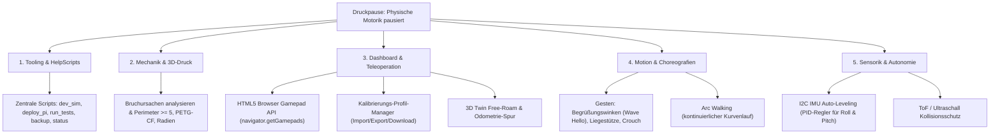

# Lasius Hexapod – Projekt-Status, Todos & How-to Leitfaden

Dieses Dokument hält den aktuellen Projektstatus fest, dokumentiert das Aufgaben-Backlog für die Phase des Coxa-Neudrucks und beschreibt die Einrichtung, Entwickler-Workflows sowie die bereitgestellten Help-Skripte.

---

## 1. Aktueller Status des Roboters (Stand: Oktober 2026)

### Mechanischer Status
* **Status:** ⚠️ **Physische Gesamt-Motorik pausiert.**
* **Ursache:** Mehrere 3D-gedruckte Coxa-Trägerteile (Hüftgelenke) sind unter Last gebrochen und müssen neu gedruckt werden.
* **Konsequenz:** Physische Geh- und Belastungstests auf dem Schreibtisch/Boden sind vorübergehend ausgesetzt, bis die verstärkten Neudrucke montiert sind.

### Software- & Digital-Twin-Status
* **Status:** ✔ **100 % betriebsbereit, modular und autark simulierbar.**
* **Backend (`lasius-core`):**
  * 4-Schichten-Architektur (HAL, Kinematik/Motion, OrderDispatcher, HTTP REST & WebSocket Server).
  * 50 Hz Harmonic-Cosine-Locomotion-Engine ($C^1$-stetig, >5-fache Ruck-Reduktion).
  * Ruckfreie Kosinus-Einstiegs- und Ausstiegsinterpolation in [`dispatcher.py`](lasius-core/src/lasius/core/control/dispatcher.py): Startwinkel basieren auf Live-Servowinkeln oder Stance-Höhe ($z = -80\,\text{mm}$), kein 0°-Durchsacken mehr.
* **Frontend (`lasius-dashboard`):**
  * Moderne Vue 3 + TypeScript + Pinia Single-Page Application (SFCs, `JointCard.vue` wiederverwendbar).
  * 3D Digital Twin (Three.js WebGL via `shallowRef`): Doppelplatten-Sandwich (zwei 5 mm Platten, 24 mm Abstand, Standoffs), Coxa 30 mm nach innen verlängert, einheitliches PBR-Material (`#343746`), blaues Richtungsdreieck auf Deck.
  * 2D CAD-Orthogonalprojektionen: Rein geradlinige Vektoren (`ctx.lineTo`) ohne Bogenkrümmung.
* **Automatisierte Tests:**
  * **58 Tests** (55 in `lasius-core`, 3 in `lasius-pilot`), 100 % bestanden.

---

## 2. Aufgaben-Backlog & Todos (während der Druckpause)

Da das gesamte System dank [`MockPWMDriver`](lasius-core/src/lasius/core/hardware/driver.py) und dem 3D Digital Twin unabhängig von echter Hardware auf dem Laptop simulierbar ist, kann die Entwicklung nahtlos fortgesetzt werden:



### Todo 1: Einrichtung, How-to und HelpScripts [✔ BEREIT]
* **Ziel:** Einheitliche Skripte für den schnellen Entwickler-Alltag (Simulation, Deployment, Backup, Health-Check).
* **Dateien:** Ordner [`scripts/`](scripts/) mit ausführbaren Bash-Skripten (siehe Abschnitt 3).

### Todo 2: Mechanische Optimierung der Coxa-Brackets (3D-Druck)
* **Bruchursachen-Analyse:**
  * Prüfen, ob Bruch entlang der Schichtlinien (Z-Achse) oder an Querschnittsübergängen/Schraubenlöchern auftrat.
* **Konstruktive Maßnahmen vor Neudruck:**
  * **Schichtorientierung:** Slicen so wählen, dass Biegekräfte parallel zu den Filamentbahnen wirken.
  * **Wandlinien (Perimeter):** Mindestens 5–6 Perimeter für massive Kraftaufnahme um die Servoflanken.
  * **Materialempfehlung:** PETG (zäher als PLA, splittert nicht spröde) oder PETG-CF / PA-CF (kohlefaserverstärkt für maximale Torsionssteifigkeit).
  * **Kerbspannungen:** Scharfe Innenecken am Übergang von der Servobox zum Achszapfen mit Radien ($r \ge 1{,}5\text{ mm}$) ausrunden.

### Todo 3: Dashboard & Teleoperation (100 % Software)
* **HTML5 Gamepad API direkt im Web-Dashboard:**
  * Bluetooth- oder USB-Controller (Xbox, PS4/PS5, Switch Pro) direkt am Laptop koppeln.
  * Browser-API `navigator.getGamepads()` im Pinia-Store auslesen:
    * Linker Stick: Translation ($X/Y$ Vektor).
    * Rechter Stick: Rotation um Z ($Turn_Z$) sowie Body Pitch & Roll.
    * Trigger/Shoulder: Body Height Z & Umschaltung der Gangarten (Tripod, Ripple, Wave).
    * Button-Mapping für Not-Aus und Gangart-Pause.
* **Kalibrierungs-Profil-Management (Download / Upload):**
  * Export/Download der `calibration.json` als Datei im Dashboard.
  * Upload/Restore von Kalibrierungen (z. B. Profile für Teststand, Teppich, Glattboden).
* **Virtuelle Odometrie & Free-Roam im 3D Digital Twin:**
  * Umschaltbare Kamera: Fixe Roboter-Kamera vs. Welt-Kamera.
  * Roboter bewegt sich in der 3D-Szene tatsächlich vorwärts (mit Breadcrumb-Pfadlinie).

### Todo 4: Gesten, Posen & Choreografien (`lasius-core`)
* **Show-Posen & Acrobatic Actions:**
  * `WAVE_HELLO`: Vorderbein anheben und die Tibia hin- und herwinkend schwenken.
  * `PUSH_UPS`: Rhythmisches Auf- und Absenken des Körpers über Sinus-Interpolation.
  * `CROUCH` / `INSPECT`: Tiefe Lauerstellung mit geneigter Nase (Pitch).
  * Alle Bewegungen lassen sich vollständig im Mock-Driver und Digital Twin entwerfen und über [`OrderAction`](lasius-core/src/lasius/core/control/orders.py) ansteuern.
* **Arc Walking (Bogenlauf):**
  * Kontinuierliche Koppelung von Translation ($X/Y$) und Yaw-Drehung ($Z$) für sauberen Kurvenlauf.

### Todo 5: Sensorik & Autonomie (Hardware-Phase 2)
* **IMU-Treiber & Auto-Leveling:**
  * Anbindung eines I2C-Sensors (MPU-6050 oder BNO055).
  * PID-Lageregelung in `lasius-core`: Schräglagen des Untergrunds werden durch automatisches Gegenneigen von `body_roll` und `body_pitch` waagerecht ausgeglichen.
* **Hinderniserkennung:**
  * Abstraktionsschicht für VL53L0X (Laser ToF) oder HC-SR04 (Ultraschall) an der Front für automatischen Annäherungsstopp.

---

## 3. Help-Skripte (`scripts/`)

Im Ordner [`scripts/`](scripts/) stehen vorgefertigte, getestete Werkzeuge zur Verfügung:

| Skript | Beschreibung | Verwendung |
| :--- | :--- | :--- |
| [`scripts/dev_sim.sh`](scripts/dev_sim.sh) | Startet lokalen Simulationsserver (Mock HAL) auf Port 8000 & 8765. | `./scripts/dev_sim.sh` |
| [`scripts/run_tests.sh`](scripts/run_tests.sh) | Führt alle 58 Unit- & Integrationstests (`core` + `pilot`) aus. | `./scripts/run_tests.sh` |
| [`scripts/deploy_pi.sh`](scripts/deploy_pi.sh) | Baut Dashboard (Vite), synct Core & Frontend per Rsync auf den Pi und lädt Server neu. | `./scripts/deploy_pi.sh [PI_IP]` |
| [`scripts/status_pi.sh`](scripts/status_pi.sh) | Fragt Live-Telemetrie, KPIs, SoC-Temperatur, Spannung und Steuerungsvektoren vom Pi ab. | `./scripts/status_pi.sh [PI_IP]` |
| [`scripts/backup_calibration.sh`](scripts/backup_calibration.sh) | Sichert `calibration.json` mit Timestamp in [`backups/`](backups/). | `./scripts/backup_calibration.sh [PI_IP]` |

---

## 4. Entwickler-How-to & Schnellstart-Leitfaden

### Szenario A: Entwicklung am Laptop ohne Roboter (Reiner Simulator)
1. **Repository klonen & Virtualenv einrichten:**
   ```bash
   python3 -m venv .venv
   source .venv/bin/activate
   pip install -e lasius-core -e lasius-pilot
   ```
2. **Dashboard-Abhängigkeiten installieren:**
   ```bash
   cd lasius-dashboard
   npm install
   npm run build
   cd ..
   ```
3. **Tests ausführen:**
   ```bash
   ./scripts/run_tests.sh
   ```
4. **Simulationsumgebung starten:**
   ```bash
   ./scripts/dev_sim.sh
   ```
   * REST API & Web-Dashboard öffnen: [http://127.0.0.1:8000](http://127.0.0.1:8000)
   * WebSocket Telemetrie-Stream: `ws://127.0.0.1:8765`

---

### Szenario B: Code auf den Raspberry Pi übertragen & deployen
Sobald am Code Änderungen vorgenommen wurden (z. B. an der Kinematik oder am Web-Interface):
```bash
./scripts/deploy_pi.sh 192.168.0.123
```
Das Skript führt automatisch folgende Schritte aus:
1. Prüft die Netzwerkverbindung zum Raspberry Pi via Ping.
2. Kompiliert das Vue 3 Dashboard mit TypeScript (`vue-tsc`) und Vite.
3. Überträgt `dist/`, `lasius-core/` und `lasius-pilot/` effizient per Rsync.
4. Löst einen sanften Neustart des Daemons über die REST-API aus.
5. Verifiziert den Server-Status (`online`).

---

### Szenario C: Live-Status & System-KPIs des Roboters prüfen
Um schnell zu sehen, ob der Roboter online ist, wie warm der Pi ist oder ob Unterspannung vorliegt:
```bash
./scripts/status_pi.sh 192.168.0.123
```
Beispiel-Ausgabe:
```text
==========================================================
📡 Querying Lasius Robot Status at http://192.168.0.123:8000...
==========================================================
Robot Status:       ONLINE
Connected Clients:  1
Active Order:       None (idle)
----------------------------------------------------------
🕹 Control Vectors:
  Gait:             tripod (Speed: 1.0x, Stride: 50.0mm)
  Walk Vector:      X=0.0, Y=1.0, TurnZ=0.0
  Body Height:      -80.0 mm
  Roll / Pitch:     0.0° / 0.0°
----------------------------------------------------------
⚡ System Health (Raspberry Pi):
  CPU Utilization:  0.2% (Load: 0.02, 0.1)
  Memory (RAM):     172.5 / 905.0 MB (19.1%)
  Power Health:     normal (Throttled: 0x0)
==========================================================
```

---

### Szenario D: Kalibrierungs-Backup erstellen
Vor dem Experimentieren mit Servotrimms oder Gelenkgrenzen immer ein lokales Backup ziehen:
```bash
./scripts/backup_calibration.sh 192.168.0.123
```
Das Backup wird mit Zeitstempel in [`backups/calibration_YYYYMMDD_HHMMSS.json`](backups/) gespeichert und auf JSON-Validität geprüft.

---

### Szenario E: Notfall-Handling & Servos stromlos schalten
Sollte der Roboter unerwartete Bewegungen machen oder mechanisch klemmen:
* **Sofort-Notstopp (E-Stop) via cURL:**
  ```bash
  curl -s -X POST http://192.168.0.123:8000/api/v1/emergency_stop
  ```
* **Alle Servos stromlos schalten (PWM aus):**
  ```bash
  curl -s -X POST http://192.168.0.123:8000/api/v1/relax
  ```
* **Im Web-Dashboard:** Den signalroten `E-Stop`-Button oben rechts anklicken.
